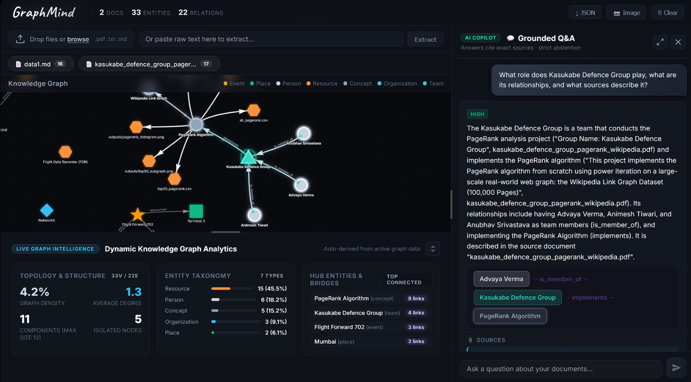

# GraphMind — Grounded Knowledge-Graph Q&A
## Live Demo

[View Live Website](https://graphmind-hacktober.onrender.com/)

[](./LICENSE)
[](https://nodejs.org/)
[](https://aistudio.google.com/)
[](https://github.com/AdityaV33/GraphMind-Hacktober/pulls)

> **Extract entities & relationships from multi-format documents, construct a live interactive Knowledge Graph, and answer complex multi-hop questions with exact source citations — zero hallucinations, guaranteed.**

GraphMind is not a chatbot on top of a vector database. It is a **graph-native reasoning engine**: every answer is grounded in a structured knowledge graph built directly from your documents, with Breadth-First Search traversal, canonical entity deduplication across documents, and automatic contradiction detection across sources.

---



---

## Key Features

| Feature | Description |
|---|---|
| **Multi-Format Ingestion** | Upload `.pdf`, `.txt`, `.md` files or paste text. PDF chunked up to 25 MB. |
| **AI Graph Extraction** | Gemini extracts typed entities (people, orgs, events, places, concepts) and directed relationships with source quotes. |
| **Cross-Document Entity Linking** | Entities mentioned in multiple documents are canonically merged — no duplicates. |
| **Interactive Visual Graph** | `vis-network` canvas with color-coded node types, animated edge traversal, and photon-pulse path highlighting. |
| **Grounded Q&A** | Answers are strictly grounded in graph facts. Every claim includes an exact source citation and quote. |
| **Conflict Detection** | Automatically surfaces contradictions when two documents assert opposing facts about the same entity pair. |
| **Multi-Hop BFS Reasoning** | Discovers indirect connections up to N hops (A -> B -> C) and visualizes the full reasoning chain on the graph. |
| **Hallucination Abstention** | When facts are not in the graph, the model explicitly declines rather than inventing an answer. |
| **Executive Briefing** | `/api/summary` synthesizes cross-document key themes, hub entities, and critical conflicts into a markdown brief. |
| **Free-Tier Safe** | Built-in 10 RPM rate limiter with backoff retry keeps well within Gemini's free-tier quota (15 RPM limit). |

---

## System Architecture

```
+------------------------------------------------------------------+
|                        CLIENT BROWSER                            |
|  index.html  <->  app.js (vis-network graph + chat UI)          |
|                   analytics.js (resizable analytics panel)       |
+------------------------------+-----------------------------------+
                               |  HTTP REST
+------------------------------v-----------------------------------+
|                     EXPRESS SERVER  (server.js)                  |
|                                                                  |
|  +--------------+    +--------------+    +------------------+   |
|  |  /api/upload |    |  /api/query  |    |  /api/summary    |   |
|  |              |    |              |    |                  |   |
|  | pdf-parse    |    | BFS subgraph |    | Hub detection    |   |
|  | chunkText()  |    | conflict scan|    | Gemini synthesis |   |
|  | Gemini NER   |    | Gemini grnd. |    |                  |   |
|  +------+-------+    +------+-------+    +---------+--------+   |
|         |                   |                       |            |
|  +------v-------------------v-----------------------v---------+  |
|  |              In-Memory Knowledge Graph Engine               |  |
|  |                                                            |  |
|  |  entities: Map<id, Entity>    (canonical, cross-doc)       |  |
|  |  relationships: Relationship[] (with conflict flags)       |  |
|  |  documents: Map<id, Document>                              |  |
|  |                                                            |  |
|  |  .addEntity()          <- normalised name deduplication    |  |
|  |  .addRelationship()    <- duplicate-safe                   |  |
|  |  .findEntities()       <- fuzzy + Jaccard similarity       |  |
|  |  .getSubgraph()        <- BFS N-hop neighbourhood          |  |
|  |  .findPath()           <- shortest-path BFS                |  |
|  |  .findConflicts()      <- opposing-claim detection         |  |
|  |  .toJSON()             <- conflict-annotated export        |  |
|  +------------------------------------------------------------+  |
|                                                                  |
|  RateLimiter (10 RPM)   .   loadEnv() hot-reload               |
+------------------------------------------------------------------+
```

### Data Flow — Document Ingestion

```
Upload PDF / TXT / MD
        |
        v
  pdf-parse (PDF only)
        |
        v
  chunkText(25,000 chars, 1,500 overlap)   <- max 6 chunks per doc
        |
        v
  buildExtractionPrompt(chunk, knownEntities)
        |
        v
  Gemini -> JSON { entities[], relationships[] }
        |
        v
  knowledgeGraph.addEntity()     <- canonical merge via Jaccard similarity
  knowledgeGraph.addRelationship()
        |
        v
  Response -> { graph, extracted counts }
```

### Data Flow — Grounded Q&A

```
Question
   |
   v
findEntities()  (fuzzy match + Jaccard similarity)
   |
   v
getSubgraph(entityIds, maxHops=3)   <- BFS neighbourhood
   |
   +-- findPath(A, B)               <- shortest-path for multi-hop
   +-- findConflicts(entityIds)     <- opposing-claim detection
   |
   v
buildQueryPrompt(facts, conflicts, question)
   |
   v
Gemini -> JSON { answer, citations[], conflicts[], reasoning_path[], highlight_nodes[], confidence }
   |
   v
Response + highlight_nodes -> client animates traversal on graph
```

---

## Quick Start

### Prerequisites
- [Node.js](https://nodejs.org/) **v18+**
- A free Gemini API key from [Google AI Studio](https://aistudio.google.com/app/apikey) (no credit card required)

### Installation

```bash
# 1. Clone the repo
git clone https://github.com/AdityaV33/GraphMind-Hacktober.git
cd GraphMind-Hacktober

# 2. Install dependencies
npm install

# 3. Configure your API key
cp .env.example .env
# Open .env and set:  GEMINI_API_KEY=your_key_here
```

### Run

```bash
# Start the server
npm start

# Auto-reloading dev mode (Node.js 18+)
npm run dev
```

Open **[http://localhost:3000](http://localhost:3000)** in your browser.

### Run Tests

```bash
# End-to-end verification suite (10 tests, requires server running)
npm test

# 20-query quantitative benchmark (requires server running in another terminal)
npm run evaluate
```

---

## Project Structure

```
GraphMind-Hacktober/
├── server.js                    # Express server + Graph engine + all API routes
├── index.js                     # npm module export (reusable engine)
├── evaluate.js                  # 20-query quantitative benchmark script
│
├── public/
│   ├── index.html               # Main dashboard shell
│   ├── app.js                   # Graph rendering, chat UI, file upload client
│   ├── analytics.js             # Resizable analytics panel
│   ├── style.css                # Dark graphite/slate theme + animations
│   └── vis-network.min.js       # Bundled vis-network (offline-safe)
│
├── sample_datasets/
│   ├── 01_corporate_mna/        # Biotech M&A due diligence (conflict: $420M vs $380M)
│   ├── 02_clinical_trials/      # FDA Phase II drug trial (conflict: 50mg vs 25mg)
│   ├── 03_cybersecurity/        # SOC-2 incident post-mortem (conflict: gateway identity)
│   └── README.md                # Scenario descriptions & expected query paths
│
├── test/
│   ├── suite.js                 # E2E verification: health, multi-hop, conflicts, abstention
│   └── analytics.test.js        # Analytics panel tests
│
├── docs/
│   └── demo.png                 # UI screenshot
│
├── .env.example                 # Environment variable template
├── LICENSE                      # MIT License
└── package.json                 # Scripts, dependencies, module entry
```

---

## API Reference

All endpoints return JSON. Base URL: `http://localhost:3000`

### Document Ingestion

| Method | Endpoint | Body | Description |
|---|---|---|---|
| `POST` | `/api/upload` | `multipart/form-data` with `file` field **or** `{ text, name }` JSON | Ingest a document (`.pdf`, `.txt`, `.md`). Extracts entities & relationships via Gemini. Returns updated graph. Max file size: **25 MB**. |

**Response:**
```json
{
  "success": true,
  "documentId": "doc_1234567890",
  "documentName": "report.pdf",
  "extracted": { "entities": 47, "relationships": 31 },
  "graph": { "entities": [...], "relationships": [...], "documents": [...] }
}
```

---

### Graph Retrieval & Management

| Method | Endpoint | Body | Description |
|---|---|---|---|
| `GET` | `/api/graph` | — | Return the full knowledge graph with conflict-annotated edges (`isConflict: true`). |
| `GET` | `/api/stats` | — | Document, entity, and relationship counts. |
| `POST` | `/api/clear` | — | Reset the in-memory graph (removes all documents, entities, relationships). |
| `DELETE` | `/api/documents/:id` | — | Remove a specific document and recalculate the graph. |
| `POST` | `/api/documents/:id/delete` | — | Same as DELETE (fallback for clients that don't support DELETE). |

---

### Grounded Q&A

| Method | Endpoint | Body | Description |
|---|---|---|---|
| `POST` | `/api/query` | `{ "question": "..." }` | Ask a grounded question. Returns answer, citations, confidence, conflicts, reasoning path, and highlight node IDs for graph animation. |

**Response:**
```json
{
  "answer": "Server Room 4B in Zurich [Source: ops_report.md]",
  "citations": [
    { "fact": "Cluster Alpha-9 is in Server Room 4B", "source": "ops_report.md", "quote": "..." }
  ],
  "confidence": "high",
  "conflicts": [],
  "reasoning_path": ["Sarah Jenkins", "-> leads ->", "Quantum Research Team", "-> allocated ->", "Cluster Alpha-9", "-> located in ->", "Server Room 4B"],
  "highlight_nodes": ["sarah_jenkins", "quantum_research_team", "cluster_alpha9", "server_room_4b"]
}
```

---

### Executive Briefing & Export

| Method | Endpoint | Body | Description |
|---|---|---|---|
| `GET` | `/api/summary` | — | AI-generated executive briefing: key themes, top hub entities, critical conflicts, and cross-document insights. |
| `GET` | `/api/export` | — | Export the entire graph as a portable JSON snapshot (`version: "1.0"`). |
| `POST` | `/api/import` | Graph JSON from `/api/export` | Restore a previously exported graph. |
| `POST` | `/api/demo` | — | Load the built-in 2-document demo scenario (Project Alpha cross-document conflict). |
| `GET` | `/api/health` | — | Server health, Gemini API configuration status, model name, and current graph stats. |

---

## Benchmark Evaluation

GraphMind ships with a 20-query benchmark script (`evaluate.js`) covering 3 enterprise domains. Each domain contains two documents with intentional cross-document contradictions.

### Evaluation Categories

| Category | Queries | What is Measured |
|---|---|---|
| Multi-Hop Traversal | 8 | Does the answer correctly resolve a 3-4 hop entity chain? Does `reasoning_path` exist? |
| Conflict Detection | 6 | Does the answer surface both sides of an opposing claim? Are `conflicts[]` returned? |
| Hallucination Abstention | 6 | Does the model return `confidence: "unsupported"` for questions whose answers are not in any document? |

### Running the Benchmark

```bash
# Terminal 1 — start the server
npm start

# Terminal 2 — run the benchmark
npm run evaluate
```

The script loads each domain's documents via `/api/upload`, fires all 20 queries against `/api/query`, and prints a scorecard showing Multi-Hop Recall, Conflict Detection F1, Abstention Accuracy, and Citation Fidelity.

---

## Sample Benchmark Datasets

Three judge-ready enterprise scenarios are included in `sample_datasets/`:

### Scenario 1 — Corporate M&A Due Diligence (`01_corporate_mna/`)
- **Doc 1**: Apex Holdings acquires NovaBio Therapeutics for **$420M**; Dr. Aris Thorne is VP of Genomic Discovery.
- **Doc 2** (Forensic Audit): Valuation revised to **$380M**; Dr. Thorne stepped down due to non-compete violation.
- **Multi-Hop**: "Which city houses the facility with patents directed by Dr. Aris Thorne?"
  Path: Dr. Aris Thorne -> Omics Research Lab -> Cambridge BioHub -> **Cambridge, Massachusetts**
- **Conflict**: "What is the agreed acquisition price?" -> surfaces $420M vs $380M

### Scenario 2 — Clinical Trial Safety (`02_clinical_trials/`)
- **Doc 1** (FDA Protocol): NX-109 maintenance dose = **50 mg/day**; principal investigator Dr. Miriam Chen at Charite Berlin.
- **Doc 2** (Safety Board): Emergency reduction to **25 mg/day** after liver toxicity; oversight transferred to Dr. Hans Meyer.
- **Multi-Hop**: "Which city is home to the hospital where NX-109 trial was initiated?"
  Path: NX-109 -> Dr. Miriam Chen -> Charite University Hospital -> **Berlin, Germany**

### Scenario 3 — Cybersecurity Post-Mortem (`03_cybersecurity/`)
- **Doc 1** (SOC-2 Report): Breach via **Bastion Gateway 04** in Frankfurt Datacenter; VPN credential stuffing.
- **Doc 2** (SIEM Forensics): Actual entry via **API Gateway 09** in Dublin Datacenter; SSRF exploit; VPN was a decoy.
- **Conflict**: "What was the initial penetration vector?" -> surfaces Bastion GW04/credential stuffing vs API GW09/SSRF

---

## Use as a Reusable npm Module

GraphMind's graph engine and REST API can be imported independently:

```js
const { app, knowledgeGraph, callGemini, chunkText } = require('graphmind');

// Mount on a custom port
app.listen(4000);

// Or use the graph engine directly
knowledgeGraph.addDocument('d1', 'My Report', text);
const subgraph  = knowledgeGraph.getSubgraph(['entity_id'], 2);
const path      = knowledgeGraph.findPath('nodeA', 'nodeB');
const conflicts = knowledgeGraph.findConflicts(['entity_id']);
```

**Exported API surface:**

| Export | Type | Description |
|---|---|---|
| `app` | `Express` | The configured Express application |
| `knowledgeGraph` | `Object` | In-memory graph engine with all traversal methods |
| `rateLimiter` | `RateLimiter` | Shared Gemini rate limiter (10 RPM) |
| `chunkText(text, size, overlap)` | `Function` | Split text into overlapping chunks |
| `parsePDF(buffer)` | `Function` | Extract text from a PDF buffer |
| `callGemini(prompt, retries)` | `Function` | Call Gemini with backoff retry |
| `getGeminiModel()` | `Function` | Return a configured Gemini model instance |
| `normalizeEntityName(name)` | `Function` | Normalize for cross-doc deduplication |

---

## Environment Variables

| Variable | Required | Default | Description |
|---|---|---|---|
| `GEMINI_API_KEY` | Yes | — | Your Google AI Studio API key |
| `GEMINI_MODEL` | No | `gemini-3.5-flash-lite` | Gemini model name to use |
| `PORT` | No | `3000` | HTTP port the server listens on |

Variables are hot-reloaded on every request — edit `.env` without restarting the server.

---

## Rate Limiting & Free-Tier Safety

GraphMind ships with a built-in queue-based rate limiter targeting **10 RPM** — a deliberate safety margin below Gemini's free-tier cap of 15 RPM.

- **Document ingestion**: Each 25,000-char chunk = 1 Gemini call. A 60-page PDF uses approximately 6 calls.
- **Q&A queries**: 1 call per question.
- The rate limiter queues requests automatically and never fires more than 10 calls per 60-second rolling window.

---

## Contributing

Pull requests are welcome. For major changes, please open an issue first to discuss what you would like to change.

1. Fork the repo
2. Create your feature branch: `git checkout -b feat/my-feature`
3. Commit your changes: `git commit -m 'feat: add my feature'`
4. Push to the branch: `git push origin feat/my-feature`
5. Open a Pull Request

---

## License

[MIT](./LICENSE) — free to use, modify, and distribute.

---

<p align="center">Built for MLH Hacktober 2026 · <a href="https://github.com/AdityaV33/GraphMind-Hacktober">GraphMind-Hacktober</a></p>
